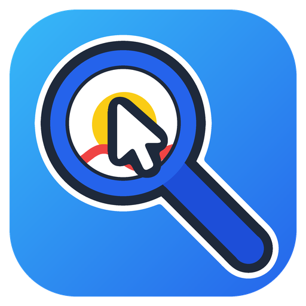

# ClassZoom

수업 화면 도구: **화면 캡처 · 라이브 줌 · 마우스 하이라이트 · 드로잉 · 화면 녹화** (Windows 10 / 11, macOS 14 이상)

화면을 3단계로 실시간 확대하고, 그 위에 그리고, 마우스 위치를 강조합니다. 확대 화면은 Zoom·Google Meet 화면 공유와 녹화에 그대로 보이고, **마우스 커서는 하나만** 보입니다.



## 내려받기 (설치 없음)

1. [Releases](https://github.com/codersongpro/mouse/releases/latest)에서 `ClassZoom-버전.exe`를 받습니다.
2. 바탕화면이나 문서 폴더에 두고 바로 실행합니다. 설치나 압축 풀기가 필요 없습니다.
3. 파란 "Windows의 PC 보호" 창이 뜨면 **추가 정보 → 실행**을 누릅니다 (전자서명이 없는 개인 제작 프로그램에 늘 뜨는 안내입니다).

사용안내·라이선스 파일까지 받으려면 `ClassZoom-버전.zip`을 받습니다. zip 안에는 `classzoom.exe`, `사용안내.txt`, `LICENSE.txt`, `licenses/`(FFmpeg LGPL 라이선스)가 들어 있습니다. **실행 파일은 `classzoom.exe` 하나**이고, 녹화 엔진(FFmpeg·녹화 도우미)은 그 안에 들어 있다가 처음 녹화할 때 `%LOCALAPPDATA%\ClassZoom\engine`에 한 번 꺼내집니다.

처음 실행하면 **사용 방법 안내 창**이 뜹니다(위젯 버튼과 단축키 정리). "다음부터 보지 않기"를 체크하면 다음 실행부터 뜨지 않고, 트레이 메뉴 **사용 방법**이나 설정 → 일반 탭의 **사용 방법 보기**로 언제든 다시 열 수 있습니다.

## 위젯

| 버튼 | 기능 |
|---|---|
| 카메라 | 화면 캡처 — 클릭하면 창, 끌면 구역을 찍고 편집 창 열기 (`F6`, 오른쪽 클릭: 전체 화면 등) |
| 돋보기 | 라이브 줌 — 누를 때마다 **1단계 → 2단계 → 3단계 → 끄기** (`F7`) |
| 노란 원 + 커서 | 마우스 하이라이트 켜기/끄기 (`F8`) |
| 연필 | 드로잉 켜기/끄기 (`F9`) |
| 빨간 점 | 화면 녹화 시작/정지 (`F10`) |
| 톱니바퀴 | 설정 |

위젯 기본색은 눈에 잘 띄는 연노랑이고, 켜진 기능은 버튼 바탕이 하늘색으로 바뀝니다. 버튼에 마우스를 올리면 이름과 단축키가 뜹니다. 위젯은 기본으로 **항상 다른 창 위에** 보이며 설정 → 위젯 탭에서 끌 수 있습니다(끄더라도 드로잉·라이브 줌·녹화 중에는 위에 보임). 배경색·크기·투명도도 같은 탭에서 바꿉니다.

## 전자칠판 모드 (Windows)

칠판 앞에서 키보드 없이 손가락만으로 쓰는 모드입니다. 설정 → 위젯 탭의 **전자칠판 모드**, 또는 위젯을 **길게 누르거나 오른쪽 클릭**한 메뉴에서 켭니다. 터치 화면이 있는 PC에서는 처음 한 번 켤지 묻습니다.

| 항목 | 내용 |
|---|---|
| 위젯 | 1.5배 크기의 **세로 막대**, 화면 오른쪽 아래에 섭니다 (끌어서 옮길 수 있음) |
| 확대 | 돋보기 아래 **+ / −** 버튼 (− 를 1단계에서 누르면 끄기) |
| 드로잉 팔레트 | 드로잉을 켜면 위젯 옆에 열립니다: 색 6가지(빨강·파랑·초록·노랑·검정·흰색), 굵게 / 가늘게, 지우개(켜면 손가락으로 지움), 전부 지우기 |

## 확대

| 항목 | 내용 |
|---|---|
| 단계 | `F7` 또는 돋보기 버튼: 1단계 **150%** → 2단계 **200%** → 3단계 **300%** → 끄기. 바뀔 때 커서 옆에 "확대 2단계 · 200%"가 잠깐 뜹니다 |
| 단계 바꾸기 | 확대 중 `Ctrl` + 마우스 휠 |
| 끄기 | `Esc` (드로잉 중이면 첫 `Esc`는 드로잉을 끄고, 한 번 더 누르면 확대가 꺼짐) |
| 실시간 | 캡처한 그림이 아니라 살아 있는 화면입니다. 영상도 그대로 움직입니다 |
| 화면 이동 | 평소에는 화면이 고정되고 커서만 움직입니다. 커서를 가장자리 쪽으로 가져가면 그쪽으로 화면이 이동합니다 (흔들림 없음) |
| 클릭 | 확대 화면에서 커서가 가리키는 곳이 그대로 클릭됩니다 |
| 드로잉 | 확대 중 드로잉(`F9`)으로 확대된 화면 위에 그대로 그립니다. 확대를 끄면 원래 크기로 그 자리에 남습니다 |
| 설정 | 설정 → **확대** 탭: 단계별 배율(125~800%), 부드럽게 확대·축소 |

### 왜 커서가 하나만 보이나

ZoomIt·Windows 돋보기는 화면 전체를 시스템 단계에서 키웁니다. 그러면 녹화·공유 프로그램이 ① 확대된 화면 속 커서 그림과 ② 자기가 실제 좌표에 그리는 커서를 둘 다 찍어서 커서가 두 개가 됩니다.

ClassZoom은 화면 맨 위에 **보통 창 하나**를 띄우고, 그 안에서 Windows Magnification API로 아래 화면을 키워 그립니다.

- 보통 창이라 공유·녹화 프로그램에 그대로 찍힙니다.
- 확대 중에는 진짜 커서를 투명하게 숨기고, 확대 화면 위에 ClassZoom이 그린 커서 하나만 보입니다. 녹화·공유에도 이 커서 하나만 찍힙니다.
- 진짜 커서는 늘 "확대 화면에서 그 커서가 가리키는 내용"의 실제 자리에 있어서, 클릭과 그리기가 정확히 맞습니다.
- 화면을 캡처하는 방식이 아니라서 Windows 11의 노란 캡처 테두리도 생기지 않습니다.

### 화면 공유할 때

- Zoom·Meet에서 **"화면 전체"(모니터)**를 공유하세요. 특정 창만 공유하면 확대 화면이 공유되지 않습니다.
- 모니터가 두 대면 확대는 **커서가 있는 모니터**에서 동작합니다.

## 화면 캡처

| 키 | 동작 |
|---|---|
| `F6` / 위젯 카메라 버튼 | 마우스를 올린 창에 빨간 테두리가 뜨고, 클릭하면 그 창을, **누른 채 끌면 그 구역**을 찍음 (`Esc`·오른쪽 클릭 취소) |
| `Shift` + `F6` | 커서가 있는 모니터 전체 |
| `Ctrl` + `Shift` + `F6` / 카메라 버튼 오른쪽 클릭 | 마우스로 끌어 고른 구역 |

- 찍자마자 클립보드에 복사되고 편집 창이 뜹니다: 펜 · 형광펜 · 네모 · 화살표 · 글자 · 모자이크 · 자르기, 색 7가지, 굵기 3단계, `Ctrl+Z` 되돌리기, `Ctrl+C` 복사, `Ctrl+S` 저장(`사진\ClassZoom`에 PNG), 다른 이름으로(PNG/JPG). 맥은 `⌘`.
- 보이는 화면 그대로 찍습니다. **라이브 줌 중이면 확대 화면이**, 드로잉으로 그린 것도 함께 찍힙니다. 위젯·하이라이트 원은 빠집니다.
- 편집 창을 쓰는 동안은 확대를 잠시 끄고(확대 위에서는 누르는 자리가 어긋남), 편집 창을 닫으면 같은 단계로 다시 켭니다.
- 캡처 키는 녹화 키처럼 앞 프로그램에 넘기지 않습니다(한글 `F6` 스타일 창이 함께 떠서 찍히지 않게). 예전에 다른 기능을 `F6`으로 바꿔 둔 PC에서는 그 키를 빼앗지 않고 캡처 키를 비워 둔 뒤 알립니다.
- 소스: `windows/capture.ahk`, `mac/Sources/Capture/`

## 화면 녹화

| 키 | 동작 |
|---|---|
| `F10` / 위젯 빨간 점 버튼 | 모니터 전체 녹화 시작 · 정지 (3·2·1 카운트다운) |
| `Ctrl` + `Shift` + `F10` / 녹화 버튼 오른쪽 클릭 | 마우스로 영역을 골라 그 부분만 녹화 |
| `Ctrl` + `F10` / 표시창 버튼 | 일시정지 · 계속 |

- 마이크(Windows 기본 녹음 장치)와 컴퓨터 소리를 함께 녹음합니다. 설정 → 녹화 탭에서 각각 끄고, 저장 폴더, 초당 화면 수, 화질(1080p 기본 · 720p · 원본 해상도)을 바꿉니다. 녹화를 시작할 때마다 화질을 고르는 창이 뜹니다(끌 수 있음).
- `동영상\ClassZoom` 폴더에 MP4로 저장하고 폴더를 엽니다.
- 카운트다운, "녹화 중" 표시창, 영역 테두리는 영상에 찍히지 않습니다 (Windows 10 2004 이상).
- 녹화는 `classzoom-rec.exe`(소리 캡처·진행, `windows/recorder/ClassZoomRec.cs`)와 FFmpeg(LGPL)이 합니다. H.264는 Windows 내장 인코더(Media Foundation)를 씁니다.

## 하이라이트 · 드로잉

- `F8` 마우스 하이라이트: 커서 주위를 원하는 색의 원으로 강조(설정 → 포커스 탭에서 색·크기·진하기 선택), 클릭 효과(좌·우 따로)
- `F9` 드로잉 (또는 **Caps Lock을 누르는 동안** 드로잉, 떼면 그림은 화면에 남고 클릭은 통과. 대문자 전환은 Shift + Caps Lock): 자유선, `Ctrl` 네모, `Shift` 원, `Z` 직선, `X` 물결, `C` 화살표(끝을 끌어 길이·방향 고침), `V` 움직이는 강조 화살표, `A` 레이저 펜, `S` 무지개 펜
- `1`~`9` 색, `0` 기본 색, `Q`/`W`/`E`/`R` 칠판, 오른쪽 버튼 지우개, `Ctrl+Z` 실행 취소(30단계), `Delete` 전부 지우기
- 전자칠판 터치·펜 입력, 손날 지우개, 두 손가락 실행 취소

드로잉 중 키는 설정 → 단축키 탭의 **"드로잉 모드 단축키 보기"**에서 키보드 그림으로 볼 수 있습니다.

## 단축키 바꾸기

설정 → **단축키** 탭에서 칸을 누르고 원하는 키를 누르면 바로 바뀝니다(캡처 `F6` → 라이브 줌 `F7` → 하이라이트 `F8` → 드로잉 `F9` → 녹화 `F10` 순서, 구역·전체 캡처와 녹화 일시정지·영역 녹화 키까지 모두). **기본값** 버튼으로 되돌립니다.

| 경우 | 처리 |
|---|---|
| 다른 ClassZoom 기능이 쓰는 키 | 받지 않고 어느 기능이 쓰는지 알려 줌 |
| Windows·macOS가 쓰는 키 (`Alt+Tab`, `Alt+F4`, `Ctrl+Esc`, `⌘Space`, `⌃⌘Q` 등), 드로잉 중 키(`Ctrl+Z` 등) | 받지 않음 |
| Ctrl·Alt 없는 글자 키 | 받지 않음 (글을 쓸 때마다 켜지고 꺼지므로) |
| 다른 프로그램도 흔히 쓰는 키 (`F5` 슬라이드 쇼, `Ctrl+C` 복사, 맥 `⌃A` 등) | 겹친다고 알리고 확인 후 사용 (Windows는 확인 창, 맥은 주황색 안내) |

## 처음 써 보실 때 확인할 것

문법 검사와 exe 컴파일은 GitHub Actions(Windows)에서 통과했지만, **실제 PC에서 화면을 띄워 보지는 않았습니다.**

- [ ] 처음 실행 시 사용 방법 창이 뜨고, "다음부터 보지 않기" 후 다시 실행하면 뜨지 않는다
- [ ] `F7`을 누를 때마다 1 → 2 → 3단계 → 꺼짐, 커서 옆에 단계 표시가 뜬다
- [ ] 확대·축소가 부드럽게 바뀌고, 마우스를 움직여도 화면은 고정된 채 커서만 움직인다
- [ ] F7을 여러 번 빠르게 눌러도 단계 표시가 잠시 뒤 사라진다
- [ ] 위젯 아이콘이 컬러로 보이고, 켜진 버튼은 바탕이 하늘색이 된다
- [ ] 유튜브 영상을 띄우고 확대해도 영상이 계속 움직인다
- [ ] 확대한 채로 링크·버튼을 클릭하면 커서가 가리킨 곳이 눌린다
- [ ] 확대 중 `F9` 드로잉: 화면이 고정되고 커서 끝에 정확히 그려진다
- [ ] Zoom 또는 Meet로 화면 전체를 공유했을 때 상대방에게 확대 화면이 보이고 커서가 하나다
- [ ] OBS 또는 `Win+Alt+R` 녹화 영상에서 커서가 하나다
- [ ] 화면 배율(125%, 150%)과 모니터 두 대 환경

## 알려진 제한

- DRM으로 보호된 영상(넷플릭스 등)은 확대 화면에서 검게 보일 수 있습니다.
- 모니터마다 화면 배율(DPI)이 다르면 보조 모니터에서 위치가 어긋날 수 있습니다.
- 확대 중 그린 선은 배율만큼 굵게 보입니다 (확대를 끄면 원래 굵기).
- 확대 중 커서는 늘 화살표 모양으로 보이고(손가락·I자 모양 없음), 배율만큼 빠르게 움직이는 것처럼 보입니다.
- 전자칠판에서 확대 중 손가락으로 누르면, 그리기는 보이는 자리에 되지만 다른 프로그램 클릭은 실제 화면 자리로 갑니다.

## 소스로 실행

1. [AutoHotkey v2](https://www.autohotkey.com/)를 설치합니다.
2. 저장소를 **폴더 구조 그대로** 둡니다 (`windows/`와 `shared/`가 나란히).
3. `windows\classzoom.ahk`를 더블클릭합니다.

## 새 버전 배포하기 (관리자용)

exe는 GitHub Actions(`.github/workflows/build-windows.yml`)가 Windows 서버에서 자동으로 만듭니다.

- **main에 올릴 때마다**: 문법 검사 → exe 컴파일 → zip. Actions 탭의 실행 기록 맨 아래 **Artifacts**에서 받아 시험할 수 있습니다.
- **릴리스 내기**:
  1. `windows/classzoom.ahk`에서 `;@Ahk2Exe-SetVersion`과 `APP_VERSION`을 같은 번호로 올립니다 (예: `1.0.1`).
  2. `version.txt`의 `windows=`도 같은 번호로 고칩니다 (설정 창의 "새 버전 확인"이 이 값을 봅니다).
  3. main에 올린 뒤 같은 번호의 태그를 올리면 Releases에 zip이 자동으로 게시됩니다. 태그와 `APP_VERSION`이 다르면 빌드가 멈춥니다.

```bash
git tag v1.0.1
```

```bash
git push origin v1.0.1
```

## 랜딩페이지 (Vercel)

`site/` 폴더는 ClassZoom 소개·다운로드 페이지입니다. 빌드가 필요 없는 정적 페이지라서 그대로 배포됩니다.

1. [vercel.com](https://vercel.com)에서 **Add New → Project → `codersongpro/mouse` 가져오기(Import)**
2. **Root Directory**를 `site`로 정합니다 (Framework Preset: Other, Build Command 비움).
3. **Deploy**를 누릅니다. 이후 main에 올릴 때마다 자동으로 다시 배포됩니다.

다운로드 버튼은 열릴 때 GitHub에서 최신 릴리스를 읽어 Windows는 exe, macOS는 zip 파일로 바로 연결됩니다. 새 버전을 릴리스해도 페이지를 고칠 필요가 없습니다.

## 파일 구성

```
windows/classzoom.ahk    본체 (강조·드로잉·위젯·설정)
windows/zoom.ahk         실시간 확대 (3단계)
windows/guide.ahk        처음 실행 시 사용 방법 안내 창
windows/record.ahk       화면 녹화 (시작·정지·일시정지·영역 선택)
windows/capture.ahk      화면 캡처 (창·구역·전체) + 편집 창
windows/recorder/        녹화 도우미 classzoom-rec.exe 소스 (C#)
windows/사용안내.txt      zip에 함께 들어가는 안내문
shared/                  아이콘 (icon.png 앱 아이콘, *_color.png 위젯 버튼)
version.txt              설정 창의 "새 버전 확인"이 읽는 파일
.github/workflows/       exe 자동 빌드·릴리스
site/                    랜딩페이지 (Vercel, Root Directory = site)
```

## 만든 사람

**송동석 (Songpro / Dustin)**
AI Product Builder · Educator · Data Analyst
즐거움은 더하고, 불편함은 덜고. — https://songpro.app

## 저작권 및 이용 안내

ClassZoom © 2026 송동석 (Songpro / Dustin)

- MIT 라이선스로 배포하는 무료 프로그램입니다. 누구나 사용·복사·수정·배포할 수 있습니다.
- 다시 배포할 때는 저작권 표시와 `LICENSE` 파일을 함께 넣어 주세요.
- 이 프로그램은 있는 그대로 제공되며, 사용 중 생긴 문제에 대해 만든 사람은 책임지지 않습니다.
- 개인정보를 수집하거나 외부로 보내지 않습니다. 인터넷은 설정 창을 열 때 새 버전을 확인하는 데에만 씁니다(버전 파일 1개 읽기).
- 화면 녹화에는 FFmpeg(LGPL 2.1)을 씁니다.
